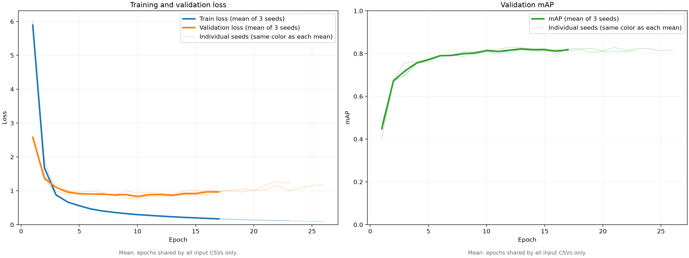
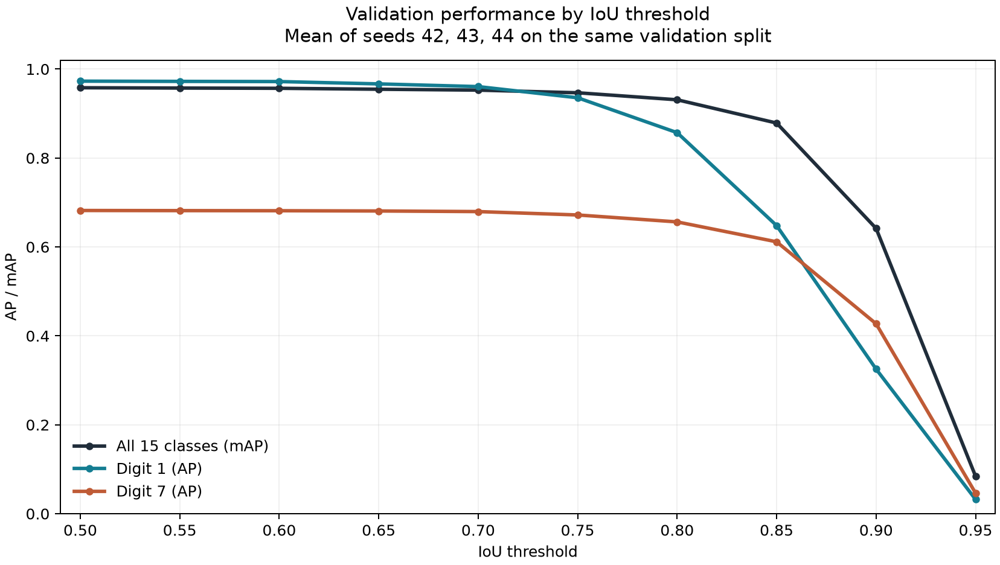

# Baseline レポート

作成日:2026-10-15  
更新日:2026-11-22（`outputs/logs/baseline/csv` の結果を反映）

## 1.実験の目的
目的は二つのオペランドと一つの演算子、末尾の=からなる数式が書かれた画像の中で数記号を認識するモデルのベースラインを作るためである。
| 項目 | 定義 |
| --- | --- |
| 予測対象 | 一つの数式につき数記号の物体検出 |
| 主評価 split | validation、4,000 件 |
| 主評価指標 | mAP@0.50:0.95（IoUは0.05刻み、APはRecallの101点補間で算出） |
| 補助指標 | なし |
| seed | 42、43、44 |
| testの扱い | 最終モデル選定まで未使用 |
| 手書き画像の扱い | 最終モデル選定まで未使用　|

## 2.データセットと分割
### 2.1データセットの規模
データはGoogle Fontsからフォントダウンロードし、generate_dataset.pyで作成した。同一の数式、フォントはsplitに入らないようにしている。
| split | 画像数 | 割合 | フォント数 |
| --- | ---: | ---: | ---: |
| train | 32000 | 80.0% | 17 |
| validation | 4000 | 10.0% | 2 |
| test | 4000 | 10.0% | 2 |
| 合計 | 40000 | 100% | 21 |

### 2.2フォントの数
フォントはそれぞれのsplitごとに均等に分けており、一枚の画像に一つのフォントを使っている。

| font | train | val | test |
| --- | ---: | ---: | ---: |
| ArchitectsDaughter-Regular | 1883 | 0 | 0 |
| Arial Unicode | 1883 | 0 | 0 |
| ComingSoon-Regular | 1883 | 0 | 0 |
| CoveredByYourGrace-Regular | 1883 | 0 | 0 |
| GochiHand-Regular | 1883 | 0 | 0 |
| HachiMaruPop-Regular | 1883 | 0 | 0 |
| IndieFlower-Regular | 1882 | 0 | 0 |
| JustAnotherHand-Regular | 1882 | 0 | 0 |
| Kalam-Light | 1882 | 0 | 0 |
| PatrickHand-Regular | 1882 | 0 | 0 |
| RocknRollOne-Regular | 1882 | 0 | 0 |
| Schoolbell-Regular | 1882 | 0 | 0 |
| ShadowsIntoLight-Regular | 1882 | 0 | 0 |
| ShortStack-Regular | 1882 | 0 | 0 |
| Yomogi-Regular | 1882 | 0 | 0 |
| YujiBoku-Regular | 1882 | 0 | 0 |
| YuseiMagic-Regular | 1882 | 0 | 0 |
| Caveat-Bold | 0 | 2000 | 0 |
| GloriaHallelujah-Regular | 0 | 2000 | 0 |
| KleeOne-Regular | 0 | 0 | 2000 |
| ZenKurenaido-Regular | 0 | 0 | 2000 |
| 合計 | 32000 | 4000 | 4000 |

### 2.3数記号の数

今回のデータセットはコードを使って自己生成しており、分布的には想定通りとなった。
0が十の位に入らない影響で他の数字に比べ、件数が少なくなっている。

| 数記号 | train | val | test |
| --- | ---: | ---: | ---: |
| + | 7953 | 1022 | 1025 |
| - | 7995 | 1006 | 999 |
| 0 | 6417 | 779 | 804 |
| 1 | 12730 | 1637 | 1633 |
| 2 | 12793 | 1548 | 1659 |
| 3 | 12787 | 1638 | 1575 |
| 4 | 12807 | 1579 | 1614 |
| 5 | 12781 | 1625 | 1594 |
| 6 | 12837 | 1581 | 1582 |
| 7 | 12812 | 1613 | 1575 |
| 8 | 12865 | 1549 | 1586 |
| 9 | 12741 | 1652 | 1607 |
| = | 32000 | 4000 | 4000 |
| × | 8035 | 977 | 988 |
| ÷ | 8017 | 995 | 988 |
| 総数記号数 | 185570 | 23201 | 23229 |

### 2.4データセット生成方法
| 項目 | 生成内容 |
| --- | --- |
| random_seed | 42 |
| 画像サイズ | 800x200 |
| フォントサイズ | 画像ごとに50から130の間をランダムに決める |
| 文字色 | 黒 |
| 背景色 | 白 |
| 画像の端の余白 | フォントのサイズに応じて決める | 
| 横方向の間隔 | 文字幅の合計と画像内の残りスペースに応じて決める |
| 上下の変動幅 | 配置パターン、フォントサイズ、利用可能な高さに応じて決める |
| 文字の明るさの閾値 | 明るさ240未満を文字の一部として扱う |
| 正解ボックスの余白 | 文字から15ピクセル |

## 3.モデル

### 3.1モデル仕様
| 項目 | 設定 |
| --- | --- |
| 検出モデル | SSD300 (torchvisionの`ssd300_vgg16`) |
| backbone | VGG16ベースの特徴量抽出器 (SSD用の追加特徴抽出層を含む) |
| 事前学習 | torchvision SSD300_VGG16_Weights |
| 分類ヘッド | 16クラス用に置換し、ランダムに初期化 |
| 回帰ヘッド | 事前学習済みの重みを引き継ぐ |
| 入力 | RGB、300 x 300 |
| 出力 | SSDClassificationHead + SSDRegressionHead |
| train augmentation | なし |
| 損失 | 重みあり `localization loss`と`confidence loss`の和 `α=1`|
| optimizer | SGD |
| learning rate | 1e-3 |
| batch size | 64 |
| 最大 epoch | 100 |
| scheduler / weight decay | LambdaLR / 5e-4 |
| early stopping | validation mAP, patience 5, `min_delta=1e-4` |
| Mixed Precision | CUDA実行時に有効 |

学習率はepoch単位で更新した。第1 epochでは1×10⁻⁴とし、4 epochの線形ウォームアップを経て、第5 epochで1×10⁻³に到達する設定とした。その後はコサイン減衰により、第100 epochで1×10⁻⁵となるスケジュールを設定した。ただし、実際の学習はearly stoppingにより途中で終了したため、最小学習率には到達していない。

### 3.2checkpoint と early stopping
validation mAP がそれまでの best を更新したとき checkpoint を保存する。early stopping は `min_delta=1e-4` を超える改善が5 epoch連続でなければ停止する。以下は学習中に記録された validation mAP であり、`training_seed_summary.csv` と各 seed の `training_results_seed*.csv` から集計した。

| seed | best epoch | best mAP | 実行epoch数 | 最終epoch mAP | bestからの低下 |
| --- | ---: | ---: | ---: | ---: | ---: |
| 42 | 12 | 0.8300 | 17 | 0.8154 | 0.0147 |
| 43 | 21 | 0.8301 | 26 | 0.8178 | 0.0123 |
| 44 | 18 | 0.8187 | 23 | 0.8158 | 0.0029 |

3 seed の best mAP の平均は **0.8263 ± 0.0066**（標本標準偏差）である。

第5・6節は、各 seed の best checkpoint を再読込し、混合精度を使用せず validation 全4,000件を再評価した CSV の結果を示す。学習中の best mAP とは評価時の数値精度が異なるため、値がわずかに一致しない場合がある。

## 4.学習曲線

3 seed の個別曲線を薄線、3 seed すべてに記録がある epoch の平均を濃線で示す。seed 42・43・44 はそれぞれ17・26・23 epochで終了しているため、平均曲線は第1〜17 epochのみ描画した。

学習損失は全 seed で低下する一方、validation loss は序盤に低下した後、後半では上昇している。validation mAP は0.8前後で伸びが鈍化し、best以降は改善せずearly stoppingに至った。これらの傾向から、後半には過学習の兆候が見られる。

## 5.フォント別分析

seed 42、43、44 ごとの `map_0.50_0.95` と、その単純平均・標準偏差を示す。出典は `outputs/logs/baseline/csv/map_by_font_seed*.csv`。
標準偏差は3 seed 間の標本標準偏差（分母は n−1）とし、平均・標準偏差は丸め前の値から計算した。表示は小数第4位までとする。

| フォント名 | seed 42 mAP | seed 43 mAP | seed 44 mAP | 平均 | 標準偏差 |
| --- | ---: | ---: | ---: | ---: | ---: |
| Caveat-Bold | 0.8199 | 0.8161 | 0.7990 | 0.8117 | 0.0112 |
| GloriaHallelujah-Regular | 0.8449 | 0.8455 | 0.8408 | 0.8437 | 0.0026 |

平均mAPは両フォントとも0.8以上であり、GloriaHallelujah-Regular（0.8437）がCaveat-Bold（0.8117）を上回った。Caveat-Boldはseed 44で0.7990となり、標準偏差も0.0112と、GloriaHallelujah-Regularの0.0026より大きい。

## 6.数字記号別分析

seed 42、43、44 ごとの `ap_0.50_0.95` と、その単純平均・標準偏差を示す。出典は `outputs/logs/baseline/csv/ap_by_character_seed*.csv`。
標準偏差は3 seed 間の標本標準偏差（分母は n−1）とし、平均・標準偏差は丸め前の値から計算した。表示は小数第4位までとする。

| 数字・記号 | seed 42 AP | seed 43 AP | seed 44 AP | 平均 | 標準偏差 |
| --- | ---: | ---: | ---: | ---: | ---: |
| 0 | 0.8830 | 0.8913 | 0.8740 | 0.8828 | 0.0087 |
| 1 | 0.7501 | 0.7681 | 0.7745 | 0.7642 | 0.0127 |
| 2 | 0.8244 | 0.8260 | 0.8275 | 0.8260 | 0.0015 |
| 3 | 0.7872 | 0.8334 | 0.8038 | 0.8081 | 0.0234 |
| 4 | 0.8523 | 0.7645 | 0.8139 | 0.8102 | 0.0440 |
| 5 | 0.8134 | 0.8219 | 0.7973 | 0.8109 | 0.0125 |
| 6 | 0.8592 | 0.8844 | 0.8733 | 0.8723 | 0.0126 |
| 7 | 0.6030 | 0.6279 | 0.5146 | 0.5818 | 0.0596 |
| 8 | 0.8526 | 0.8692 | 0.8628 | 0.8615 | 0.0084 |
| 9 | 0.8520 | 0.8323 | 0.8271 | 0.8371 | 0.0132 |
| + | 0.8719 | 0.8705 | 0.8542 | 0.8655 | 0.0099 |
| - | 0.8420 | 0.8481 | 0.8477 | 0.8460 | 0.0034 |
| × | 0.8706 | 0.8448 | 0.8524 | 0.8559 | 0.0133 |
| ÷ | 0.8657 | 0.8643 | 0.8711 | 0.8670 | 0.0036 |
| = | 0.9182 | 0.9023 | 0.8892 | 0.9032 | 0.0145 |
| 全体 mAP | 0.8297 | 0.8299 | 0.8189 | 0.8262 | 0.0063 |

全体 mAP は、各 seed で validation 全4,000件を再評価した15クラスのAPの単純平均である。この行の平均・標準偏差は、各 seed の全体 mAP から計算した。

0はデータ数が他の数字より少ないが、平均APは0.8828と数字の中で最も高かった。一方、1と7は他の数字とデータ数が近いにもかかわらず、平均APがそれぞれ0.7642、0.5818と0.8を下回った。

7は全 seed でAPが最も低く、seed 44では0.5146となった。標準偏差も0.0596と全クラスで最も大きい。4も標準偏差が0.0440と比較的大きく、seed間のばらつきが見られる。

記号の平均APは0.8460〜0.9032で、=が0.9032と全クラスで最も高かった。=以外の記号は各数字（0を除く）よりデータ数が少ないものの、高い平均APを示した。

### 6.1 IoU別の分析：1と7で異なる低下の特徴

既存のクラス別CSVはIoUごとのAPも持つ。主指標だけでは位置合わせの厳しさと検出結果の関係が見えないため、これを再集計した。表はすべて3 seedの単純平均である。

| IoU閾値 | 全体mAPの平均 | 1の平均AP | 7の平均AP |
| --- | ---: | ---: | ---: |
| 0.50 | 0.9580 | 0.9728 | 0.6820 |
| 0.75 | 0.9467 | 0.9355 | 0.6719 |
| 0.85 | 0.8786 | 0.6480 | 0.6115 |
| 0.90 | 0.6417 | 0.3253 | 0.4272 |
| 0.95 | 0.0842 | 0.0320 | 0.0462 |

数字1はIoU 0.50では平均AP 0.9728だが、IoU条件を厳しくするとAPが下がる。これは、正解矩形との厳密な位置合わせで性能が低下することを示しており、主指標の低さを直ちに「1を他クラスと取り違えるため」と解釈する根拠にはならない。

数字7はIoU 0.50の平均APも0.6820であり、厳しいIoU条件だけで低下しているわけではない。ただし、検出漏れ・クラス誤り・重複検出・大きな位置ずれの寄与は、この集計から分離できない。

全体でもIoU 0.95では平均mAPが0.0842まで低下する。APは位置とクラスの両方を要求する指標であり、保存CSVだけでは、個々の予測がどの理由で不正解になったかは復元できない。本書では誤検出画像・混同行列・誤り内訳を測定しておらず、1と7の相互混同や特定の字形の影響を事実として主張しない。

## 7.次のやること
7や1のmAPが低い原因を探す。
- **数字xフォントのmAPを出す。**
苦手がフォントがあるのか。両フォント苦手なのか確かめる
- **正解枠・予測枠・予測クラス・スコアを重ねて見る**
失敗例や成功例を確認し、仮説を立てる

